|  |  |
| -------- | --- |
| **Nama** | Tedi Mulyadi |
| **NIM** | 312510163 |
| **Kelas** | I251B |
| **Mata Kuliah** | Pemrograman web |
| **Dosen** | Agung Nugroho, S.Kom., M.Kom. |  

---

# Toko Buku — Project UTS Pemrograman Web 1

<p align="center"></p>

## 1. Gambaran Umum Project

Website **Toko Buku** saya buat untuk memenuhi tugas UTS Pemrograman Web 1. Aplikasi ini menyediakan proses pemesanan buku, mulai dari masuk ke akun, mencari buku, menambahkan pilihan ke keranjang, menyelesaikan pemesanan, hingga memeriksa informasi pengiriman. Saya juga melengkapi website dengan riwayat transaksi dan laporan pemesanan agar setiap menu dapat digunakan.

Sesuai ketentuan soal UTS, aplikasi ini berfokus pada pengembangan **front-end** tanpa menggunakan server atau basis data. Data awal tersedia dalam `js/data.js`. Perubahan stok, keranjang, dan pesanan disimpan menggunakan `localStorage`, sedangkan informasi sesi akun disimpan sementara melalui `sessionStorage`. Kedua mekanisme tersebut memungkinkan fitur diuji secara langsung pada browser yang sama.

Saya menggunakan kombinasi warna hijau tua, krem, dan cokelat muda untuk menjaga keterbacaan dan keseragaman antarmuka. Identitas website menggunakan ikon buku terbuka dan tulisan **Toko Buku**. Gambar sampul buku berasal dari aset yang disediakan pada bahan tugas.

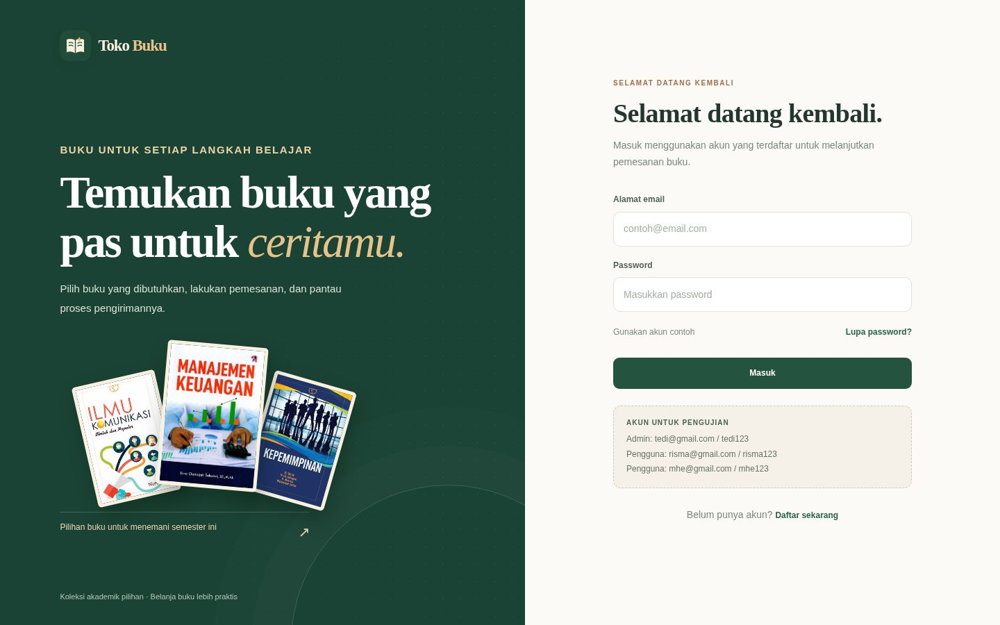

*Gambar 1. Halaman masuk dengan identitas Toko Buku.*

## 2. Struktur Folder Project

```text
tugas-uts-web1/
├── index.html                  # Halaman awal untuk login
├── login.html                  # Halaman login alternatif
├── dashboard.html              # Beranda dan menu utama
├── stok.html                   # Katalog dan informasi stok
├── checkout.html               # Keranjang serta pemesanan
├── tracking.html               # Pencarian status pengiriman
├── laporan.html                # Ringkasan laporan pemesanan
├── riwayat.html                # Riwayat transaksi
├── css/
│   └── style.css               # Gaya tampilan semua halaman
├── js/
│   ├── data.js                 # Data awal pengguna, buku, dan pelacakan
│   └── script.js               # Logika dan interaksi website
├── img/                        # Lima gambar sampul buku
├── assets/
│   ├── logo.svg                # Ikon identitas Toko Buku
│   └── book-placeholder.svg    # Pengganti gambar jika tidak tersedia
├── screenshots/                 # Screenshot output website
│   ├── 01-login.jpg
│   ├── 02-modal-daftar.jpg
│   ├── 03-dashboard-admin.jpg
│   ├── 04-katalog-admin.jpg
│   ├── 05-modal-ubah-stok.jpg
│   ├── 06-katalog-user.jpg
│   ├── 07-checkout.jpg
│   ├── 08-pesanan-berhasil.jpg
│   ├── 09-tracking.jpg
│   ├── 10-riwayat.jpg
│   ├── 11-laporan-admin.jpg
│   └── 12-dashboard-hp.jpg
└── README.md                   # Penjelasan project dan hasil tampilan
```

Setiap halaman HTML disimpan dalam file terpisah agar navigasi dan pemeliharaan lebih mudah. Pengaturan tampilan berada di folder `css`, sedangkan data awal dan logika interaksi disimpan dalam folder `js`.

## 3. Cara Menjalankan Aplikasi

1. Buka folder `tugas-uts-web1` di **Visual Studio Code**.
2. Pasang ekstensi **Live Server** jika belum ada.
3. Klik kanan `index.html`, lalu pilih **Open with Live Server**.
4. Masuk menggunakan salah satu akun pengujian berikut.

| Jenis akun | Nama | Email | Password |
|---|---|---|---|
| Admin | Tedi | `tedi@gmail.com` | `tedi123` |
| Pengguna | Risma | `risma@gmail.com` | `risma123` |
| Pengguna | Mhe | `mhe@gmail.com` | `mhe123` |

**Hak akses:** Tedi memiliki akses Admin untuk menambahkan buku dan memperbarui stok. Risma dan Mhe memiliki akses Pengguna untuk melihat katalog serta membuat pesanan, tanpa fasilitas pengelolaan stok. Pembatasan ini diterapkan pada JavaScript di sisi browser sebagai kebutuhan tugas, sehingga belum setara dengan pengamanan pada aplikasi yang menggunakan server.

Apabila data pengujian dari versi sebelumnya masih terlihat, jalankan website melalui jendela penyamaran (*Incognito*). Data yang tersimpan dalam `localStorage` tidak otomatis terhapus ketika file project diperbarui.

## 4. Penerapan HTML

HTML digunakan untuk menyusun struktur halaman. Elemen semantik, seperti `header`, `main`, `section`, `nav`, `aside`, `form`, dan `footer`, digunakan sesuai fungsi masing-masing. Contoh struktur formulir masuk:

```html
<form id="login-form">
  <div class="field">
    <label for="login-email">Alamat email</label>
    <input id="login-email" type="email" required>
  </div>
  <div class="field">
    <label for="login-password">Password</label>
    <input id="login-password" type="password" required>
  </div>
  <button type="submit">Masuk</button>
</form>
```

*Contoh kode disederhanakan dari struktur `index.html` untuk memperlihatkan komponen utamanya.* Atribut `type="email"` membantu memeriksa format alamat email, sedangkan `required` menandai kolom yang wajib diisi. Tombol dengan `type="submit"` digunakan untuk menjalankan pemeriksaan formulir melalui JavaScript.

Elemen HTML `<dialog>` digunakan untuk membuat **jendela dialog** yang dapat dibuka dan ditutup menggunakan JavaScript. Jendela dialog ini digunakan pada proses pendaftaran akun, pemulihan password, dan perubahan stok buku.

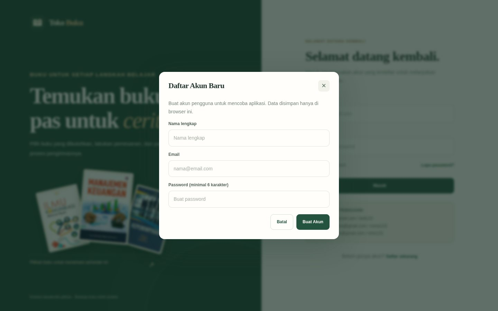

*Gambar 2. Jendela dialog pendaftaran akun pada halaman masuk.*

## 5. Penerapan CSS

CSS mengatur warna, jarak antarelemen, tipografi, tombol, tabel, dan tata letak responsif. Project ini menggunakan tiga jenis penerapan CSS sesuai materi UTS:

- **CSS eksternal:** aturan utama berada di `css/style.css` dan dipanggil dengan `<link rel="stylesheet" href="css/style.css">`.
- **CSS internal:** terdapat contoh `<style>` pada halaman login dan dashboard.
- **CSS sebaris (inline):** beberapa elemen menggunakan atribut `style`, misalnya untuk jarak atau warna tulisan tertentu.

Contoh konsep yang digunakan pada file `css/style.css`:

```css
.brand-name {
  font-family: 'Fraunces', Georgia, serif;
  font-size: 23px;
  font-weight: 650;
}

@media (max-width: 620px) {
  .brand-name {
    font-size: 22px;
  }
}
```

Aturan `@media` menyesuaikan ukuran dan susunan elemen berdasarkan lebar layar. Jenis huruf `Georgia` digunakan sebagai alternatif ketika font utama tidak tersedia.

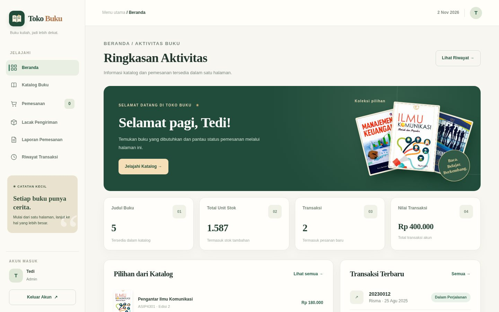

*Gambar 3. Halaman utama Admin menampilkan sapaan otomatis, ringkasan data, dan navigasi.*

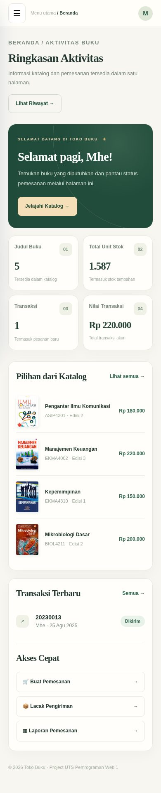

*Gambar 4. Tampilan halaman utama yang menyesuaikan ukuran layar ponsel.*

## 6. Penerapan JavaScript dan Pengelolaan Data

### 6.1 Data Awal dari `data.js`

Sesuai ketentuan soal, data berasal dari variabel JavaScript dan tidak diambil dari basis data. File `js/data.js` memuat tiga kelompok data:

- `dataPengguna`: daftar email, password, nama, dan jenis hak akses akun.
- `dataKatalogBuku`: kode, nama, jenis, edisi, stok, harga, dan gambar buku.
- `dataTracking`: nomor DO, pemesan, ekspedisi, status, dan perjalanan pengiriman.

Contoh salah satu objek buku pada data awal:

```javascript
{
  kodeBarang: "ASIP4301",
  namaBarang: "Pengantar Ilmu Komunikasi",
  jenisBarang: "Buku Ajar",
  edisi: "2",
  stok: 548,
  harga: "Rp 180.000",
  cover: "img/pengantar_komunikasi.jpg"
}
```

### 6.2 Penentuan Halaman dan Elemen DOM

Di `js/script.js`, atribut `data-page` pada `<body>` membantu kode menentukan fitur mana yang perlu dijalankan. Saya memakai `querySelector` untuk mencari elemen HTML.

```javascript
const PAGE = document.body.dataset.page || 'login';
const $ = (sel, root = document) => root.querySelector(sel);
```

Contohnya, JavaScript menggunakan elemen `#stock-rows` untuk menampilkan katalog secara otomatis. Dengan demikian, baris pada tabel tidak perlu dituliskan satu per satu dalam HTML.

### 6.3 Proses Masuk dan Pemeriksaan Formulir

Saat tombol **Masuk** ditekan, JavaScript membaca alamat email dan password, kemudian mencocokkannya dengan data akun. Apabila tidak sesuai, halaman menampilkan peringatan sebagaimana ditentukan dalam soal UTS.

```javascript
const user = allUsers().find(x =>
  normalize(x.email) === email && x.password === password
);

if (!user) {
  window.alert('email/password yang anda masukkan salah');
  return;
}
```

*Potongan kode diambil dari alur masuk pada `script.js`, dengan beberapa bagian disingkat.* Setelah berhasil, sesi akun disimpan dalam `sessionStorage` dan pengguna diarahkan ke halaman utama. Akun yang didaftarkan melalui formulir selalu memperoleh hak akses `User`, bukan `Admin`.

### 6.4 Pengaturan Hak Akses Pengelolaan Stok

Sebelum menampilkan atau menjalankan fitur pengelolaan stok, JavaScript memeriksa hak akses akun. Fungsi `isAdmin()` mencocokkan sesi pengguna dengan daftar Admin di `data.js`. Akun dengan hak akses Pengguna tidak memperoleh tombol Edit pada katalog.

```javascript
const requireStockAdmin = () => {
  if (isAdmin()) return true;
  toast('Penambahan buku dan perubahan stok hanya dapat dilakukan oleh Admin.', 'error');
  return false;
};
```

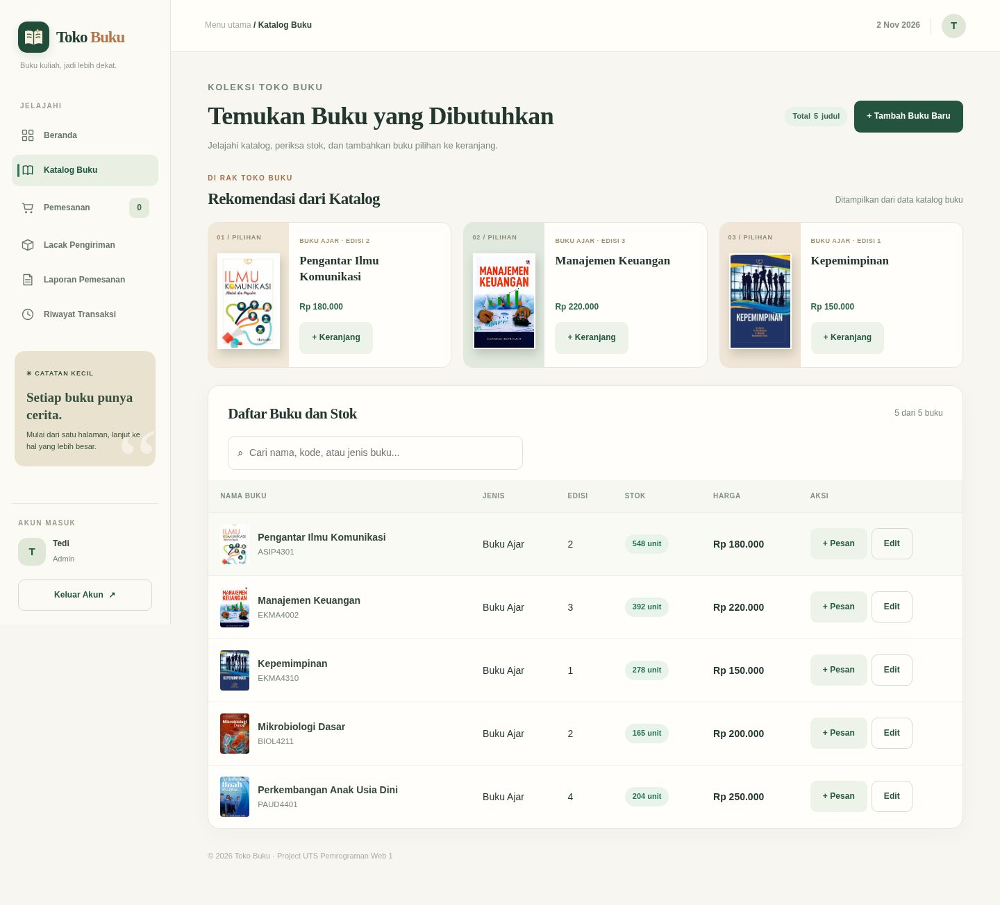

*Gambar 5. Katalog Admin menyediakan fitur penambahan buku dan perubahan stok.*

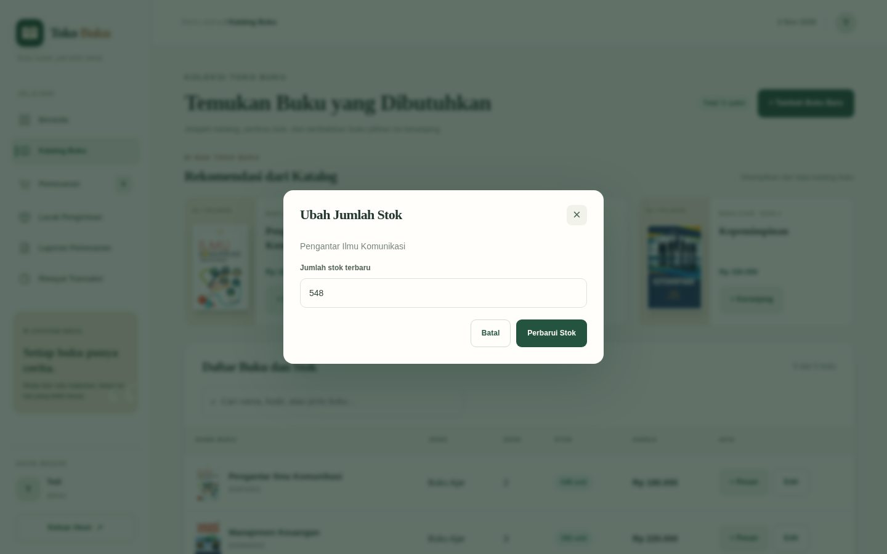

*Gambar 6. Jendela dialog perubahan stok setelah tombol Edit dipilih.*

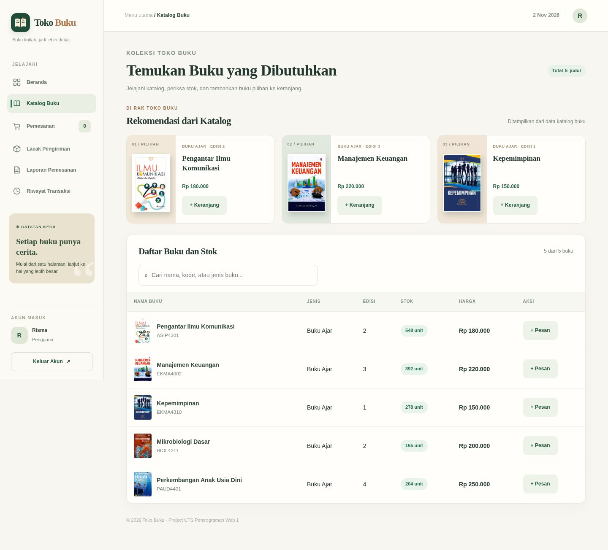

*Gambar 7. Katalog akun Pengguna menyediakan pemesanan tanpa akses pengelolaan stok.*

### 6.5 Penyimpanan `localStorage` dan `sessionStorage`

Karena aplikasi tidak menggunakan basis data, penyimpanan browser dibagi menjadi dua bagian sesuai fungsinya.

```javascript
const read = (key, fallback) => {
  try {
    const x = JSON.parse(localStorage.getItem(key));
    return x ?? fallback;
  } catch {
    return fallback;
  }
};

const write = (key, value) =>
  localStorage.setItem(key, JSON.stringify(value));
```

`localStorage` menyimpan perubahan katalog, keranjang, akun baru, dan pesanan pada browser. `sessionStorage` menyimpan sesi akun selama tab digunakan. Data tersebut tidak tersinkronisasi secara otomatis ke komputer atau browser lain.

### 6.6 Pemesanan dan Perhitungan Total

Pada `checkout.html`, pengguna dapat mengubah jumlah buku serta melengkapi nama, email, nomor telepon, alamat, layanan pengiriman, dan metode pembayaran. JavaScript memeriksa ketersediaan stok dan kelengkapan formulir. Setelah pemesanan berhasil, data disimpan, stok dikurangi, dan nomor Delivery Order (DO) diterbitkan untuk pelacakan.

Di `script.js`, total dihitung dari nilai buku dan biaya pengiriman. Contoh logika sederhananya:

```javascript
const total = subtotal + shipping;
```

Biaya pengiriman menggunakan nilai contoh. Sistem pembayaran hanya menggambarkan alur pemesanan dan tidak memproses dana melalui bank atau dompet digital.

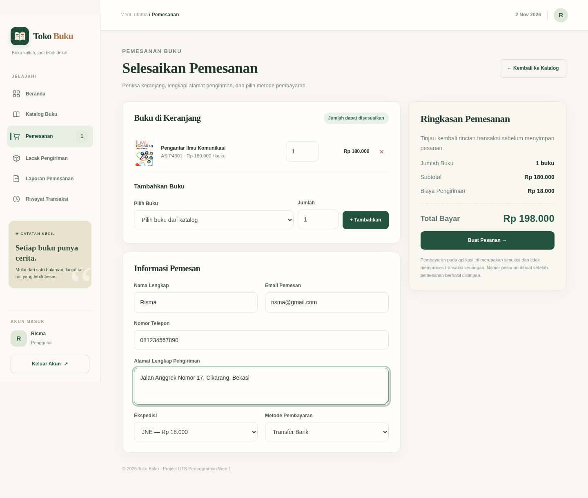

*Gambar 8. Keranjang, formulir pemesan, layanan pengiriman, dan ringkasan pembayaran.*

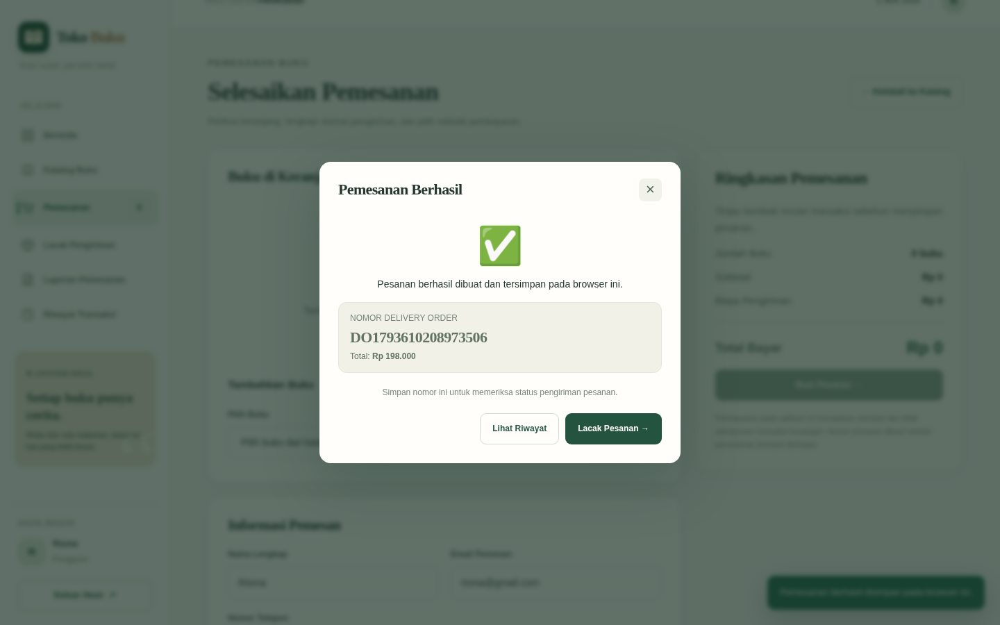

*Gambar 9. Jendela dialog konfirmasi beserta nomor DO setelah pemesanan berhasil.*

### 6.7 Pelacakan Pengiriman, Riwayat, dan Laporan

Pada `tracking.html`, pengguna memasukkan nomor DO dan memilih tombol **Cari Pengiriman**. JavaScript mencari data yang sesuai, lalu menampilkan nama pemesan, status pengiriman, ekspedisi, tanggal, jenis paket, total pembayaran, dan riwayat perjalanan.

Nomor DO contoh untuk dicoba:

- `20230012` — Risma, menggunakan JNE.
- `20230013` — Mhe, menggunakan Pos Indonesia.

Nomor DO dari pemesanan baru juga dapat digunakan pada fitur pelacakan. Status pengiriman berasal dari data simulasi, bukan informasi langsung dari layanan ekspedisi.

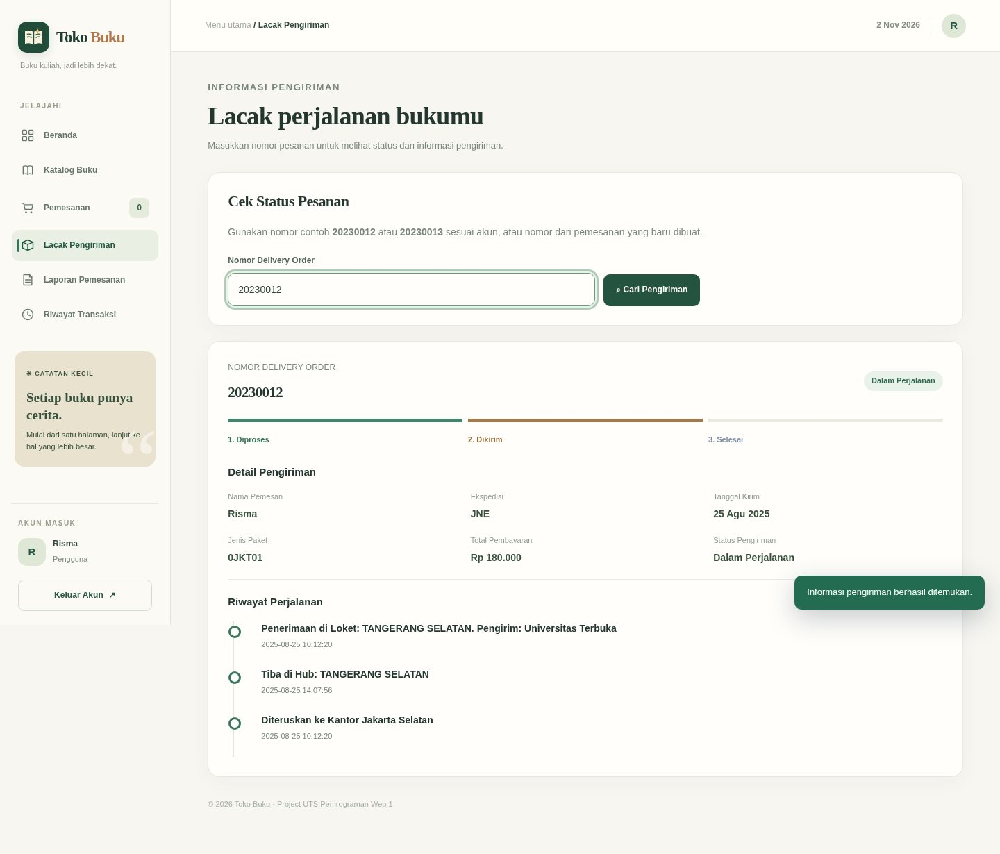

*Gambar 10. Hasil pencarian nomor DO dengan informasi perjalanan pengiriman.*

Halaman `riwayat.html` menyediakan daftar transaksi beserta rinciannya. Halaman `laporan.html` menampilkan rekap pesanan, penyaringan data, dan fitur cetak. Kedua halaman tersebut melengkapi menu utama website.

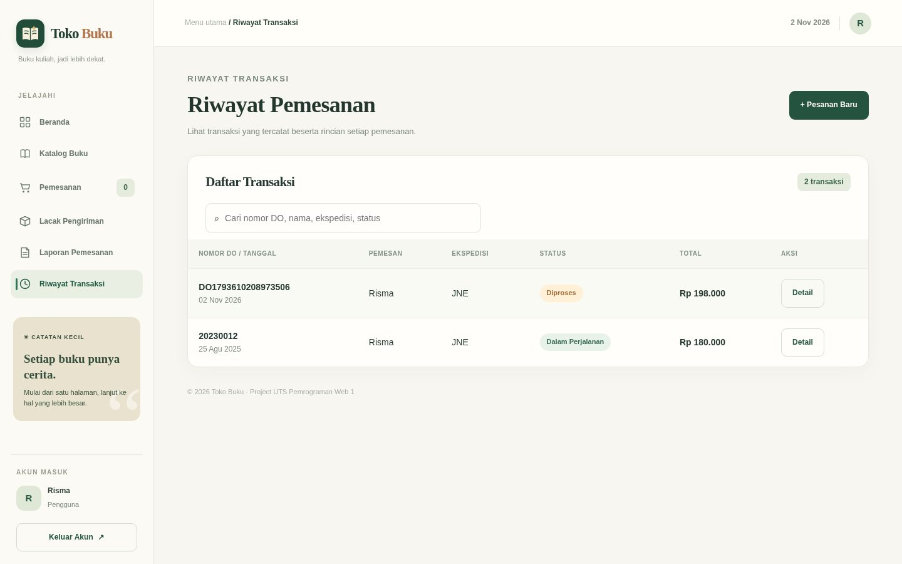

*Gambar 11. Daftar riwayat transaksi berdasarkan akun yang sedang masuk.*

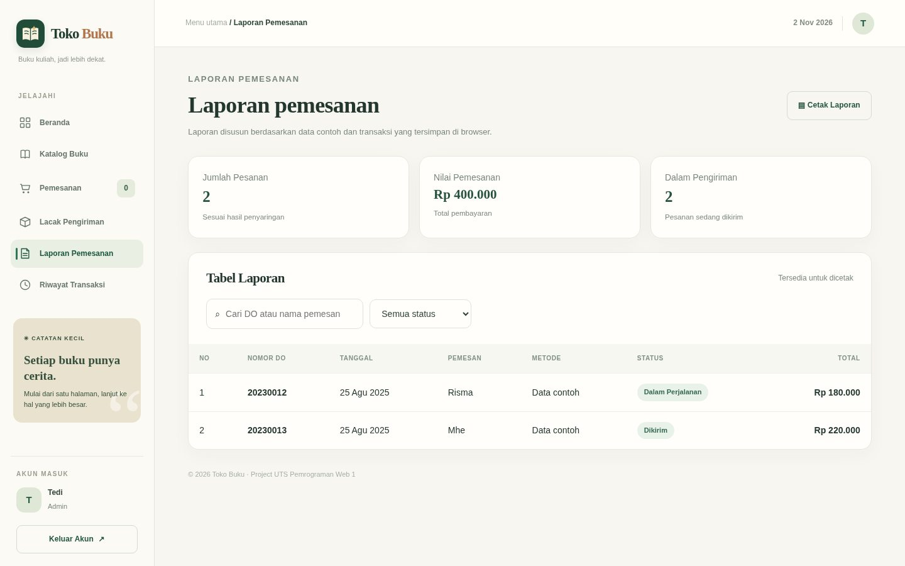

*Gambar 12. Tabel laporan pemesanan dan ringkasan nilai transaksi.*

## 7. Alur Penggunaan Website

1. **Masuk:** pengguna masuk dengan email dan password yang tersedia.
2. **Halaman utama:** website menampilkan sapaan sesuai waktu setempat dan menu utama.
3. **Katalog:** pengguna melihat daftar buku, jumlah stok, harga, dan mencari judul tertentu.
4. **Pengelolaan stok (Admin):** Tedi dapat menambah buku baru atau mengubah jumlah stok.
5. **Pemesanan:** Risma atau Mhe memasukkan buku ke keranjang dan mengisi formulir pemesanan.
6. **Konfirmasi:** website menampilkan nomor DO dan menyimpan transaksi secara lokal.
7. **Pelacakan:** nomor DO digunakan untuk memeriksa status dan perjalanan pesanan.
8. **Riwayat dan laporan:** transaksi bisa ditinjau dari halaman yang sudah disediakan.

## 8. Kesimpulan

Melalui project Toko Buku, saya menerapkan HTML, CSS, dan JavaScript dalam satu rangkaian fitur yang saling berhubungan. HTML menyusun struktur halaman, CSS mengatur tampilan responsif, dan JavaScript menangani interaksi serta perubahan data. Walaupun belum terintegrasi dengan server atau basis data, aplikasi ini sudah menunjukkan proses masuk, pengelolaan katalog, pemesanan, dan pelacakan sederhana sesuai ruang lingkup tugas UTS.
